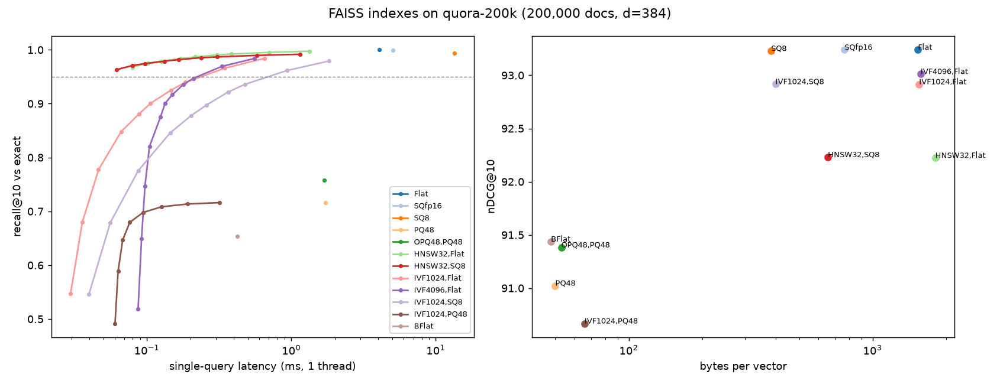

# Results

Generated by `hse report` from the JSON files in this folder.

## Retrieval quality (nDCG@10, BEIR test split)

| system | fiqa | nfcorpus | scifact | mean |
|---|---|---|---|---|
| bm25 | 23.83 | 32.07 | 68.04 | 41.31 |
| dense | 40.35 | 34.28 | 70.57 | 48.40 |
| hybrid | 41.13 | 35.34 | 72.18 | 49.55 |
| hybrid+ce-only | 38.46 | 34.83 | 69.76 | 47.68 |
| hybrid+rerank | 41.96 | 35.72 | 71.71 | 49.79 |

Full pipeline vs dense-only: +1.40 points; vs BM25-only: +8.48 points (mean over 3 datasets).

Paired t-test p-values per dataset:

- fiqa: hybrid+rerank vs bm25: 3.91e-50, hybrid+rerank vs dense: 0.000739, hybrid+rerank vs hybrid: 0.0069, hybrid+rerank vs hybrid+ce-only: 2.82e-08, hybrid vs dense: 0.0514
- nfcorpus: hybrid+rerank vs bm25: 5.03e-05, hybrid+rerank vs dense: 0.00158, hybrid+rerank vs hybrid: 0.237, hybrid+rerank vs hybrid+ce-only: 0.0547, hybrid vs dense: 0.00121
- scifact: hybrid+rerank vs bm25: 0.0111, hybrid+rerank vs dense: 0.134, hybrid+rerank vs hybrid: 0.423, hybrid+rerank vs hybrid+ce-only: 0.0766, hybrid vs dense: 0.00107

## FAISS benchmark: quora-200k (200,000 docs, 10,000 queries, d=384)

Latency is single-query, single-thread, averaged over 1000 queries. Recall point = fastest setting with recall@10 >= 0.95 against exact search (or the best recall reached if none get there). Quality point = fastest setting within 0.5 nDCG points of exact search.

| index | recall point | B/vector | compression | build s | recall@10 | latency ms | speedup | nDCG@10 | delta pts | quality point | speedup at quality point |
|---|---|---|---|---|---|---|---|---|---|---|---|
| Flat | - | 1536 | 1.0x | 0.0 | 1.000 | 4.068 | 1.0x | 93.24 | +0.00 | - | 1.0x |
| SQfp16 | - | 768 | 2.0x | 0.0 | 0.999 | 5.063 | 0.8x | 93.24 | +0.00 | - | 0.8x |
| SQ8 | - | 384 | 4.0x | 0.0 | 0.994 | 13.540 | 0.3x | 93.23 | -0.01 | - | 0.3x |
| PQ48 | - | 50 | 30.7x | 11.7 | 0.716 | 1.718 | 2.4x | 91.02 | -2.22 | not reached | - |
| OPQ48,PQ48 | - | 53 | 29.0x | 44.1 | 0.758 | 1.695 | 2.4x | 91.38 | -1.86 | not reached | - |
| HNSW32,Flat | efSearch=16 | 1808 | 0.8x | 3.9 | 0.968 | 0.079 | 51.3x | 92.22 | -1.02 | efSearch=32 | 32.4x |
| HNSW32,SQ8 | efSearch=16 | 656 | 2.3x | 3.5 | 0.963 | 0.062 | 65.7x | 92.23 | -1.01 | efSearch=32 | 41.7x |
| IVF1024,Flat | nprobe=64 | 1552 | 1.0x | 1.0 | 0.966 | 0.346 | 11.8x | 92.92 | -0.32 | nprobe=64 | 11.8x |
| IVF4096,Flat | nprobe=128 | 1576 | 1.0x | 3.7 | 0.969 | 0.331 | 12.3x | 93.01 | -0.23 | nprobe=64 | 19.4x |
| IVF1024,SQ8 | nprobe=64 | 400 | 3.8x | 1.1 | 0.961 | 0.932 | 4.4x | 92.92 | -0.32 | nprobe=64 | 4.4x |
| IVF1024,PQ48 | nprobe=128 | 66 | 23.3x | 13.1 | 0.716 | 0.318 | 12.8x | 90.67 | -2.57 | not reached | - |
| BFlat | - | 48 | 32.0x | 0.0 | 0.654 | 0.424 | 9.6x | 91.44 | -1.80 | not reached | - |

With top-100 rescoring against float32 vectors kept on disk:

| index | recall@10 | latency ms | nDCG@10 | delta pts |
|---|---|---|---|---|
| PQ48 + rescore | 0.994 | 1.799 | 93.24 | -0.00 |
| OPQ48,PQ48 + rescore | 0.997 | 1.786 | 93.24 | +0.00 |
| BFlat + rescore | 0.965 | 0.468 | 93.23 | -0.01 |



## Margin-based rerank routing (held-out half of queries)

| dataset | reranked | no rerank | full rerank | routed | random, same share | gain recovered | full rerank ms | routed ms | mean cut |
|---|---|---|---|---|---|---|---|---|---|
| fiqa | 95% | 42.45 | 43.20 | 43.18 | 43.16 | 97% | 259 | 244 | 6% |
| nfcorpus | 14% | 33.16 | 33.69 | 33.32 | 33.24 | 30% | 253 | 42 | 84% |
| scifact | 0% | 67.79 | 66.97 | 67.79 | 67.79 | n/a (reranker hurts) | 252 | 7 | 97% |

Latency measured end to end per query on `cpu`.

## Environment

```
{
  "python": "3.11.14",
  "platform": "macOS-27.0.1-arm64-arm-64bit",
  "cpu": "Apple M4 Pro",
  "faiss": "1.15.1",
  "torch": "2.14.1",
  "sentence_transformers": "6.1.0",
  "commit": "f75051e"
}
```
